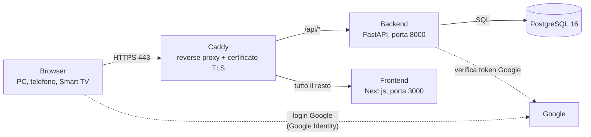
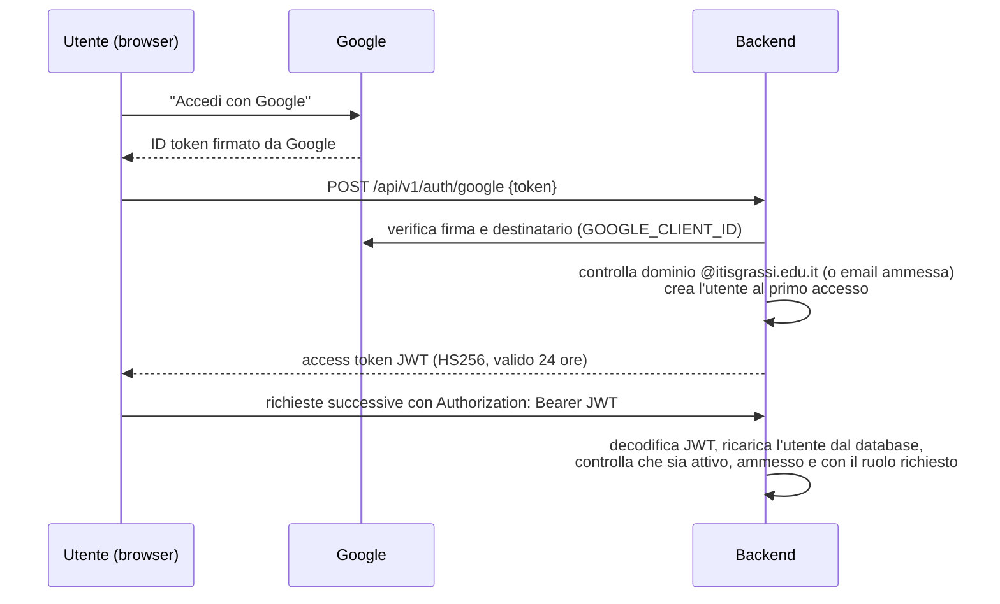
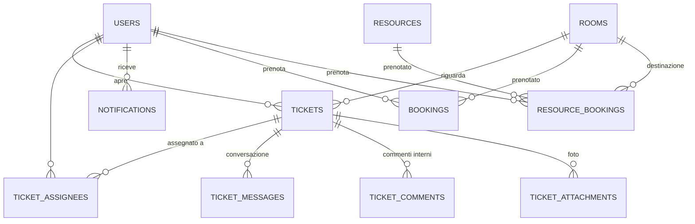

# Documentazione tecnica — Gestionale Ufficio Tecnico ITTS C. Grassi

Applicazione web per l'Ufficio Tecnico di una scuola superiore: segnalazione e gestione dei guasti (ticket), prenotazione di aule, laboratori e carrelli di PC portatili, dashboard per la TV dell'ufficio e statistiche.

- Repository: <https://github.com/giovannidedonno03-hash/aula-monitor-system>
- Ambiente online: <https://utgrassi.vps.webdock.cloud> (accesso solo con account della scuola)

## Indice

1. [Architettura](#1-architettura)
2. [Tecnologie](#2-tecnologie)
3. [Struttura del progetto](#3-struttura-del-progetto)
4. [Ruoli e permessi](#4-ruoli-e-permessi)
5. [Funzionalità](#5-funzionalità)
6. [Modello dei dati](#6-modello-dei-dati)
7. [API esposte e autenticazione](#7-api-esposte-e-autenticazione)
8. [Sicurezza](#8-sicurezza)
9. [Configurazione e installazione](#9-configurazione-e-installazione)

---

## 1. Architettura

L'applicazione è divisa in tre servizi Docker, più un reverse proxy in produzione:



- **Frontend (Next.js)**: tutte le pagine sono componenti client React; i dati arrivano dal backend tramite chiamate REST (`fetch`) con il token di accesso nell'header `Authorization: Bearer`.
- **Backend (FastAPI)**: espone le API REST sotto `/api/v1`, applica regole e permessi, salva i dati con SQLAlchemy.
- **Database (PostgreSQL)**: unico punto di persistenza. In produzione non è raggiungibile da internet (nessuna porta esposta).
- **Caddy** (solo produzione): ottiene e rinnova da solo il certificato HTTPS (Let's Encrypt) e smista le richieste: `/api/*` al backend, il resto al frontend. Sito e API hanno così lo stesso indirizzo.

### Flusso di autenticazione



Il ruolo non viene letto dal token ma ricaricato dal database a ogni richiesta: un cambio di ruolo o una disattivazione hanno effetto immediato.

### Migrazioni del database

Non si usa uno strumento di migrazione esterno: all'avvio il backend crea le tabelle mancanti (`create_all`) ed esegue una serie di istruzioni SQL idempotenti (`ADD COLUMN IF NOT EXISTS`, aggiornamento di ruoli e stati dalle versioni precedenti, ecc.), quindi aggiornare il codice e riavviare è sufficiente.

## 2. Tecnologie

| Livello | Tecnologia |
|---|---|
| Frontend | Next.js 16 (App Router), React 19, TypeScript 5, Tailwind CSS 4, next-themes (tema chiaro/scuro), @react-oauth/google |
| Backend | Python 3.11, FastAPI, Uvicorn, SQLAlchemy 2, Pydantic 2, python-jose (JWT), google-auth |
| Database | PostgreSQL 16 |
| Infrastruttura | Docker e Docker Compose; Caddy 2 come reverse proxy HTTPS; server VPS Ubuntu (Webdock) |
| Autenticazione | Google Identity Services (OAuth 2.0 / OpenID Connect) + JWT dell'applicazione |

## 3. Struttura del progetto

```
aula-monitor-system/
├── docker-compose.yml          # sviluppo sul PC (next dev, uvicorn --reload)
├── docker-compose.prod.yml     # produzione (Caddy, next build/start, database chiuso)
├── deploy/Caddyfile            # reverse proxy e HTTPS
├── DEPLOY.md                   # guida all'installazione sul server
├── aule_esempio.csv            # elenco dei locali (stesso formato dell'import)
├── backend/
│   ├── main.py                 # API FastAPI, migrazioni all'avvio
│   ├── app/
│   │   ├── models.py           # tabelle (SQLAlchemy)
│   │   ├── schemas.py          # formati di richieste e risposte (Pydantic)
│   │   ├── auth.py             # login Google, JWT, ruoli, dominio ammesso
│   │   ├── bookings.py         # regole delle prenotazioni dei locali
│   │   ├── resources.py        # regole delle prenotazioni dei carrelli
│   │   ├── notifications.py    # creazione delle notifiche
│   │   └── room_import.py      # import dei locali da CSV
│   ├── data/
│   │   ├── aule_grassi.csv     # elenco ufficiale dei 126 locali
│   │   └── orario_lezioni.json # orario delle lezioni (ore occupate per locale)
│   ├── import_aule.py          # script: sostituisce i locali con l'elenco ufficiale
│   ├── crea_ticket_prova.py    # script: 20 ticket di prova
│   └── seed.py                 # dati di prova iniziali
└── frontend/src/app/
    ├── page.tsx                # Dashboard
    ├── ticket/                 # elenco ticket e "Assegnate a me"
    ├── kanban/                 # bacheca Kanban
    ├── statistiche/            # statistiche
    ├── prenotazioni/           # prenotazione aule (+ gestione/ per le approvazioni)
    ├── carrelli/               # prenotazione carrelli PC
    ├── aule/                   # elenco e gestione dei locali
    ├── utenti/                 # gestione utenti e ruoli
    ├── tv/                     # dashboard TV a schermo intero
    ├── components/             # barra laterale, barra superiore, login, dettaglio ticket, notifiche...
    └── lib/constants.ts        # tipi, etichette e funzioni condivise
```

## 4. Ruoli e permessi

Gli studenti non hanno accesso. Possono entrare solo account Google `@itisgrassi.edu.it` (più eventuali email di prova elencate in `ALLOWED_EXTRA_EMAILS`). Il primo account della scuola che accede diventa Supervisore; tutti gli altri nuovi utenti sono Utente e il Supervisore ne cambia il ruolo dalla pagina Gestione Utenti.

| Ruolo | Descrizione |
|---|---|
| **Supervisore** | Responsabile dell'Ufficio Tecnico: ha tutti i permessi |
| **Manager UT** | Personale dell'Ufficio Tecnico: lavora i ticket |
| **Responsabile Lab** | Docente responsabile di laboratorio |
| **Assistente Tecnico** | Assistente tecnico (AT) di laboratorio |
| **Utente** | Docente o personale: apre segnalazioni e prenota |

| Operazione | Supervisore | Manager UT | Responsabile Lab / Assistente Tecnico / Utente |
|---|:-:|:-:|:-:|
| Aprire un ticket, vedere i propri ticket | ✔ | ✔ | ✔ |
| Vedere **tutti** i ticket, Kanban, Assegnate a me, Statistiche, Dashboard TV | ✔ | ✔ | — |
| Cambiare stato, prendere/lasciare in carico, inoltrare a FACTOTUM | ✔ | ✔ | — |
| Assegnare un ticket a uno o più tecnici | ✔ | — | — |
| Commenti interni | ✔ | ✔ | — |
| Conversazione sul ticket e foto allegate | ✔ | ✔ | solo sui propri ticket |
| Eliminare una foto | ✔ (tutte) | solo le proprie | solo le proprie |
| Eliminare un ticket | ✔ (tutti) | solo i propri | solo i propri |
| Prenotare aule e carrelli, annullare le proprie prenotazioni | ✔ | ✔ | ✔ |
| Approvare / rifiutare prenotazioni di aule | ✔ (tutti i locali) | ✔ (tutti i locali) | solo il responsabile del locale (email impostata nella scheda del locale) |
| Vedere le prossime prenotazioni di un locale | ✔ | ✔ | responsabile e assistente tecnico del locale |
| Gestire locali (creare, modificare, import CSV, attivare, eliminare) | ✔ | — | — |
| Gestire carrelli (creare, modificare, eliminare) | ✔ | — | — |
| Caricare l'orario delle lezioni | ✔ | — | — |
| Gestire utenti e ruoli | ✔ | — | — |

## 5. Funzionalità

### Ticket (segnalazioni guasti)
- Campi: locale, plesso (Sede Principale / Gianelli, ricavato dal locale), categoria (Informatico, Elettrico, Idraulico, Edile, Arredi, Sicurezza, Altro), priorità (Bassa, Media, Alta, Urgente), titolo, descrizione.
- Stati: **Aperto → In Carico → In Esecuzione → Inoltrato a FACTOTUM → Risolto**. L'inoltro a FACTOTUM (piattaforma della Città metropolitana di Torino per gli interventi sugli edifici scolastici) registra codice pratica, note e data.
- Storico: data di inserimento, presa in carico e chiusura; tecnici assegnati con la data di assegnazione.
- Assegnazione a più tecnici da parte del Supervisore; "Prendi in carico / Lascia" per i tecnici. Un ticket aperto che riceve un tecnico passa automaticamente In Carico.
- **Conversazione** tra chi ha segnalato e l'Ufficio Tecnico (es. "Non si avviano i programmi" → "Quale programma?" → "Office"), con indicatore "in attesa di risposta".
- **Commenti interni** riservati all'Ufficio Tecnico, con @menzioni dei colleghi.
- In conversazione e commenti si può **rispondere a un messaggio specifico** (citazione cliccabile che porta all'originale, notifica all'autore).
- **Foto allegate** (fino a 10 per ticket, JPEG/PNG/WebP, max 5 MB ciascuna): si aggiungono alla creazione o in seguito, il browser le ridimensiona prima dell'invio (lato massimo 1600 px). Sono visibili solo a chi ha segnalato e all'Ufficio Tecnico.
- Viste: elenco con filtri (stato, priorità, categoria, plesso, aula, ricerca), **Bacheca Kanban** con trascinamento tra le colonne, **Assegnate a me**.

### Prenotazione dei locali
- Griglia settimanale per ora scolastica (1ª–8ª ora, orari dell'istituto); solo i locali segnati come prenotabili.
- Preavviso minimo: da oggi + 3 giorni (il lunedì si prenota da giovedì), solo dal lunedì al venerdì.
- Le ore in cui il locale ha lezione (orario delle lezioni importato) non sono prenotabili.
- Approvazione automatica, salvo questi casi che restano **in attesa**: data oltre 30 giorni; più di 10 giorni nello stesso locale nei prossimi 30 giorni (anti-abuso); eventi a orario libero fuori dalla fascia 08:00–17:30.
- Locali a "orario libero" (es. sala riunioni): prenotazione con orario a scelta e richieste extra (microfoni, proiezione, gobbo, PC per votazioni, supporto tecnico).
- Pagina **Gestione prenotazioni**: approva / rifiuta con motivazione; prossime prenotazioni dei propri locali.

### Prenotazione dei carrelli PC
- Il Supervisore crea i carrelli indicando il numero di PC, il plesso e dove si trovano.
- Per ogni giorno e ora si prenotano **alcuni PC** o **tutto il carrello** (solo se in quelle ore nessuno ne ha già prenotati), indicando facoltativamente l'aula di destinazione. Il sistema impedisce di superare i PC disponibili.
- L'Ufficio Tecnico vede tutte le prossime prenotazioni, per preparare e portare i carrelli.

### Notifiche
Campanella con contatore, aggiornata ogni 30 secondi. Si genera una notifica quando: si viene menzionati in un commento interno; si viene assegnati a un ticket; cambia lo stato di una propria segnalazione; arriva un messaggio nella conversazione di un ticket; c'è una prenotazione da approvare, approvata o rifiutata; c'è una nuova prenotazione in un locale di cui si è assistente tecnico; qualcuno risponde a un proprio messaggio o commento. Chi compie un'azione non riceve la notifica di se stesso.

### Altro
- **Dashboard**: contatori dei ticket e ultime segnalazioni.
- **Statistiche**: tasso di risoluzione, tempi medi di presa in carico e risoluzione, carico per collaboratore, ripartizione per stato, categoria, priorità e plesso, andamento degli ultimi 14 giorni.
- **Dashboard TV**: pagina a schermo intero con contatori, colonne per stato, carico dei tecnici e ticker delle urgenze; aggiornamento ogni 30 secondi.
- **Locali**: elenco dei 126 locali della scuola con tipo, plesso, prenotabilità, responsabile, assistente tecnico e dotazioni; modifica e import CSV.
- Tema chiaro/scuro, interfaccia in italiano.

## 6. Modello dei dati



| Tabella | Contenuto principale |
|---|---|
| `users` | email, nome, foto, ruolo, attivo |
| `rooms` | codice (es. A01), tipo, plesso, prenotabile, orario libero, responsabile ed email, assistente tecnico ed email, dotazioni, attivo |
| `tickets` | codice, titolo, descrizione, stato, plesso, categoria, priorità, date (inserimento, presa in carico, chiusura, aggiornamento), dati FACTOTUM, locale, autore |
| `ticket_assignees` | tecnici assegnati a un ticket, con data e autore dell'assegnazione |
| `ticket_messages` | conversazione tra chi ha segnalato e l'Ufficio Tecnico; `reply_to_id` = messaggio a cui risponde |
| `ticket_comments` | commenti interni dell'Ufficio Tecnico; `reply_to_id` = commento a cui risponde |
| `ticket_attachments` | foto allegate: nome originale, nome casuale del file su disco, tipo, dimensione, chi l'ha caricata. I file sono nella cartella `uploads` (in produzione volume Docker `uploads_data`) |
| `notifications` | destinatario, tipo, titolo, messaggio, ticket o pagina collegata, letta |
| `bookings` | prenotazioni dei locali: una riga per ora (o una riga con orario libero), stato (Approvata, In attesa, Rifiutata), motivazioni, extra, chi ha deciso |
| `resources` | carrelli: nome, numero di PC, plesso, posizione, descrizione |
| `resource_bookings` | prenotazioni dei carrelli: giorno, ora, numero di PC, carrello intero, aula di destinazione |
| `schedule_versions` | versioni dell'orario delle lezioni (una attiva) |

## 7. API esposte e autenticazione

Base: `/api/v1`. Formato JSON. Autenticazione con header `Authorization: Bearer <JWT>` ottenuto da `POST /api/v1/auth/google`.

Legenda della colonna **Accesso**:
- **Pubblico**: nessun login richiesto.
- **Login**: qualsiasi utente autenticato (con eventuali controlli aggiuntivi indicati).
- **Supervisore, Manager** / **Supervisore**: solo questi ruoli; gli altri ricevono `403`.
- Senza login valido la risposta è `401`.

Solo **2 endpoint su 52** sono pubblici, e servono al login.

### Autenticazione

| Metodo | Endpoint | Accesso | Descrizione |
|---|---|---|---|
| POST | `/auth/google` | Pubblico | Login con l'ID token di Google; restituisce il JWT |
| GET | `/auth/config` | Pubblico | Dominio email ammesso (mostrato sotto il pulsante di login) |
| GET | `/auth/me` | Login | Dati dell'utente collegato |

### Locali

| Metodo | Endpoint | Accesso | Descrizione |
|---|---|---|---|
| GET | `/rooms` | Login | Elenco dei locali |
| POST | `/rooms` | Supervisore | Nuovo locale |
| PUT | `/rooms/{room_id}` | Supervisore | Modifica locale |
| PATCH | `/rooms/{room_id}/toggle` | Supervisore | Attiva / disattiva |
| DELETE | `/rooms/{room_id}` | Supervisore | Elimina (con ticket e prenotazioni collegati) |
| POST | `/rooms/upload-csv` | Supervisore | Crea o aggiorna locali da CSV |

### Ticket

| Metodo | Endpoint | Accesso | Descrizione |
|---|---|---|---|
| GET | `/tickets` | Login | Ufficio Tecnico: tutti i ticket; altri ruoli: solo i propri |
| POST | `/tickets` | Login | Nuova segnalazione |
| PATCH | `/tickets/{ticket_id}/status` | Supervisore, Manager | Cambio di stato (anche inoltro FACTOTUM) |
| DELETE | `/tickets/{ticket_id}` | Login | Elimina — solo l'autore o il Supervisore |
| GET | `/users/staff` | Supervisore, Manager | Tecnici assegnabili |
| PUT | `/tickets/{ticket_id}/assignees` | Supervisore | Imposta i tecnici assegnati |
| POST | `/tickets/{ticket_id}/presa-in-carico` | Supervisore, Manager | Prendi in carico |
| DELETE | `/tickets/{ticket_id}/presa-in-carico` | Supervisore, Manager | Lascia la presa in carico |
| GET | `/tickets/{ticket_id}/messages` | Login | Conversazione — solo l'autore del ticket o l'Ufficio Tecnico |
| POST | `/tickets/{ticket_id}/messages` | Login | Nuovo messaggio (con `reply_to_id` facoltativo) — solo l'autore del ticket o l'Ufficio Tecnico |
| GET | `/tickets/{ticket_id}/attachments` | Login | Elenco delle foto — solo l'autore del ticket o l'Ufficio Tecnico |
| POST | `/tickets/{ticket_id}/attachments` | Login | Carica una foto (multipart, max 5 MB, solo JPEG/PNG/WebP riconosciute dal contenuto) — solo l'autore del ticket o l'Ufficio Tecnico |
| GET | `/tickets/{ticket_id}/attachments/{attachment_id}` | Login | Scarica la foto — solo l'autore del ticket o l'Ufficio Tecnico |
| DELETE | `/tickets/{ticket_id}/attachments/{attachment_id}` | Login | Elimina la foto — solo chi l'ha caricata o il Supervisore |
| GET | `/tickets/{ticket_id}/comments` | Supervisore, Manager | Commenti interni |
| POST | `/tickets/{ticket_id}/comments` | Supervisore, Manager | Nuovo commento interno (con `reply_to_id` facoltativo) |
| DELETE | `/comments/{comment_id}` | Supervisore, Manager | Elimina commento — solo l'autore o il Supervisore |

### Notifiche, statistiche e dashboard

| Metodo | Endpoint | Accesso | Descrizione |
|---|---|---|---|
| GET | `/notifications` | Login | Le proprie notifiche e il numero di quelle da leggere |
| POST | `/notifications/{notification_id}/letta` | Login | Segna come letta (solo le proprie) |
| POST | `/notifications/lette` | Login | Segna tutte come lette |
| GET | `/dashboard/stats` | Login | Contatori per la Dashboard |
| GET | `/stats` | Supervisore, Manager | Statistiche complete |
| GET | `/tv` | Ufficio Tecnico **oppure** chiave kiosk | Dati della Dashboard TV; senza login serve `?key=` uguale a `TV_KIOSK_KEY` |

### Utenti

| Metodo | Endpoint | Accesso | Descrizione |
|---|---|---|---|
| GET | `/users` | Supervisore | Elenco utenti |
| PATCH | `/users/{user_id}/role` | Supervisore | Cambio ruolo (non si può togliere l'ultimo Supervisore) |

### Prenotazione dei locali e orario delle lezioni

| Metodo | Endpoint | Accesso | Descrizione |
|---|---|---|---|
| GET | `/bookings` | Login | Prenotazioni attive di un locale in un periodo (griglia) |
| GET | `/bookings/mine` | Login | Le proprie prossime prenotazioni (anche in attesa o rifiutate) |
| POST | `/bookings` | Login | Nuova prenotazione (regole al paragrafo 5) |
| DELETE | `/bookings/{booking_id}` | Login | Annulla — solo l'autore o il Supervisore |
| GET | `/bookings/gestione` | Login | Richieste da approvare e prossime prenotazioni dei locali di cui si è responsabili o assistenti (tutti per l'Ufficio Tecnico) |
| POST | `/bookings/{code}/approva` | Login | Approva — solo il responsabile del locale o l'Ufficio Tecnico |
| POST | `/bookings/{code}/rifiuta` | Login | Rifiuta con motivazione — solo il responsabile del locale o l'Ufficio Tecnico |
| GET | `/orario` | Login | Orario delle lezioni attivo |
| POST | `/orario` | Supervisore | Carica un nuovo orario e lo rende attivo |

### Carrelli PC

| Metodo | Endpoint | Accesso | Descrizione |
|---|---|---|---|
| GET | `/resources` | Login | Elenco dei carrelli |
| POST | `/resources` | Supervisore | Nuovo carrello |
| PUT | `/resources/{resource_id}` | Supervisore | Modifica carrello (non sotto i PC già prenotati) |
| DELETE | `/resources/{resource_id}` | Supervisore | Elimina carrello e sue prenotazioni |
| GET | `/resource-bookings` | Login | Prenotazioni di un carrello in un periodo (griglia) |
| GET | `/resource-bookings/mine` | Login | Le proprie prossime prenotazioni |
| GET | `/resource-bookings/prossime` | Supervisore, Manager | Tutte le prossime prenotazioni |
| POST | `/resource-bookings` | Login | Prenota alcuni PC o il carrello intero |
| DELETE | `/resource-bookings/{code}` | Login | Annulla — solo l'autore o l'Ufficio Tecnico |

> La documentazione interattiva generata da FastAPI (`/docs`, `/openapi.json`) è disponibile solo in sviluppo sul PC (porta 8000): in produzione Caddy inoltra al backend esclusivamente i percorsi `/api/*`.

## 8. Sicurezza

### Misure presenti
- **HTTPS** obbligatorio in produzione, con certificato automatico (Caddy / Let's Encrypt).
- **Nessuna password gestita dall'applicazione**: login tramite Google; il token di Google viene verificato lato server (firma e destinatario).
- **Accesso limitato al dominio della scuola** (`ALLOWED_EMAIL_DOMAIN`), controllato sia al login sia a ogni richiesta.
- **Autorizzazione lato server** su ogni endpoint (ruolo ricaricato dal database a ogni richiesta), più controlli di proprietà (autore del ticket, responsabile del locale, ecc.).
- **Nessun dato visibile senza login**: il frontend mostra solo la schermata di accesso; le API pubbliche sono solo le due necessarie al login. La Dashboard TV senza login richiede una chiave segreta.
- **Protezione da SQL injection**: tutte le query passano dall'ORM SQLAlchemy con parametri.
- **Protezione da XSS**: React esegue l'escape di tutti i contenuti; nel codice non si inserisce HTML non controllato.
- **Foto protette**: si scaricano solo con il token (il browser le mostra come immagini locali `blob:`), il tipo è verificato dai primi byte del file e non dall'estensione, il nome sul disco è casuale (nessun percorso scelto dall'utente).
- **Database non esposto** in produzione; password e chiavi nel file `.env`, escluso dal repository.
- **Limiti sui dati in ingresso**: lunghezza massima di ogni campo di testo (es. titolo 150 caratteri, descrizione, messaggi e commenti 4000, motivo della prenotazione 500), numero massimo di elementi nelle liste, richieste al backend al massimo di 2 MB, 5 MB per le foto (controllo sia in Caddy sia nel backend). Gli errori di validazione tornano con un messaggio in italiano.
- **Limite al numero di richieste** (rate limiting) per indirizzo IP: 1200 al minuto in generale e 30 al minuto per il login; oltre si riceve `429 Troppe richieste`. Il limite generale è alto perché tutta la scuola può uscire su internet con lo stesso IP; entrambi i valori si cambiano dal `.env`.
- **CORS** limitato al dominio del sito in produzione (`CORS_ORIGINS`), senza cookie (il token viaggia nell'header `Authorization`).
- **Intestazioni di sicurezza HTTP** aggiunte da Caddy: HSTS, `X-Content-Type-Options`, `X-Frame-Options: DENY`, `Referrer-Policy`, `Permissions-Policy` e una `Content-Security-Policy` che permette di caricare risorse solo dal sito stesso e dal login di Google.

### Limiti noti e miglioramenti previsti
- Il limite di richieste è tenuto in memoria nel backend: si azzera a ogni riavvio e vale per un singolo processo (sufficiente con un solo server).
- La `Content-Security-Policy` ammette script inline (`'unsafe-inline'`), necessari a Next.js senza configurazioni aggiuntive.
- Versioni delle librerie Python non fissate in `requirements.txt`.
- Il JWT è conservato nel `localStorage` del browser e vale 24 ore, senza possibilità di revoca anticipata (l'utente disattivato viene comunque bloccato subito).
- Chiave `SECRET_KEY` di riserva nel codice per lo sviluppo; in produzione `docker-compose.prod.yml` impedisce l'avvio senza `SECRET_KEY` nel `.env`.
- Backup automatico del database da configurare sul server.
- Dipendenza `next-auth` presente in `package.json` ma non utilizzata.

## 9. Configurazione e installazione

### Variabili d'ambiente (file `.env`, non versionato)

| Variabile | Uso |
|---|---|
| `DOMINIO` | Indirizzo del sito in produzione (es. `utgrassi.vps.webdock.cloud`) |
| `POSTGRES_PASSWORD` | Password del database (produzione) |
| `SECRET_KEY` | Chiave di firma dei JWT (produzione) |
| `GOOGLE_CLIENT_ID` | Client OAuth di Google |
| `ALLOWED_EMAIL_DOMAIN` | Dominio ammesso (default `itisgrassi.edu.it`; vuoto = qualsiasi account Google) |
| `ALLOWED_EXTRA_EMAILS` | Email ammesse in più, separate da virgola (es. account di prova) |
| `TV_KIOSK_KEY` | Chiave per la Dashboard TV senza login (`/tv?kiosk=CHIAVE`); vuota = solo con login |
| `CORS_ORIGINS` | Siti da cui il browser può chiamare le API, separati da virgola; vuoto = tutti (sviluppo). In produzione è impostato in automatico a `https://DOMINIO` |
| `RATE_LIMIT_PER_MINUTE` | Richieste al minuto per IP (default 1200) |
| `LOGIN_LIMIT_PER_MINUTE` | Tentativi di login al minuto per IP (default 30) |
| `UPLOAD_DIR` | Cartella delle foto allegate (default `backend/uploads`; in produzione `/data/uploads`, volume `uploads_data`) |

### Avvio
- **Sviluppo sul PC**: `docker compose up -d` → sito su `http://localhost:3000`, API su `http://localhost:8000`.
- **Produzione**: `docker compose -f docker-compose.prod.yml up -d --build` (guida completa in [DEPLOY.md](DEPLOY.md)).
- **Locali**: `docker compose exec backend python import_aule.py --conferma` carica l'elenco ufficiale.
- **Aggiornamento in produzione**: `git pull` e di nuovo `docker compose -f docker-compose.prod.yml up -d --build`; le migrazioni del database sono automatiche.
